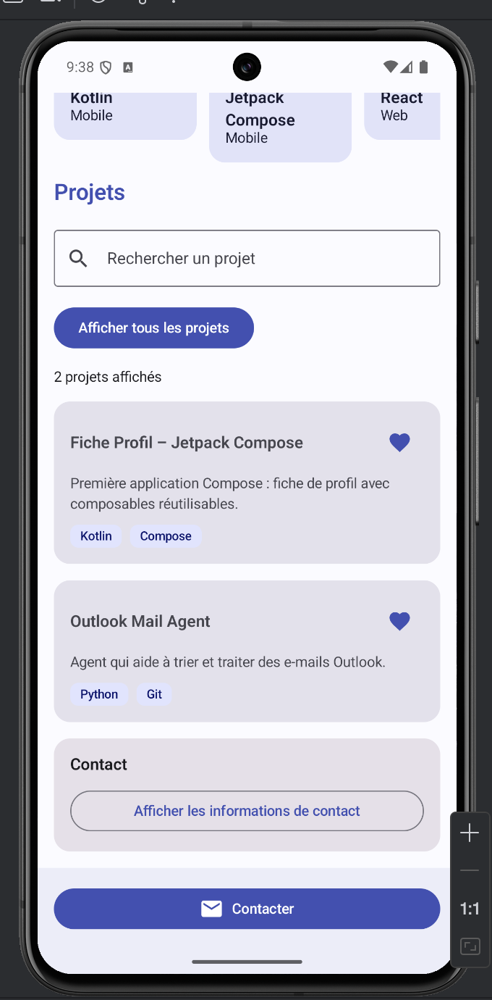
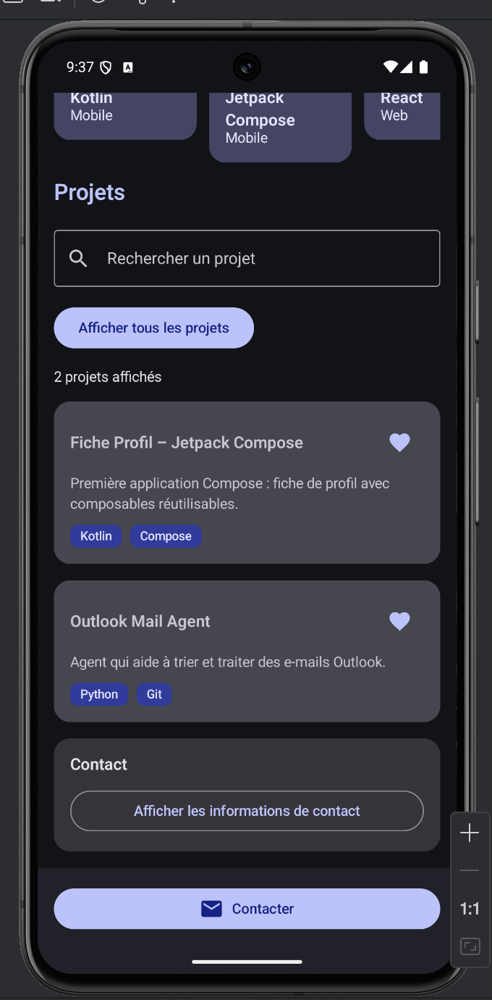

# Profil développeur interactif

## Description

Application Android (Kotlin, Jetpack Compose, Material Design 3) qui présente le profil d'un développeur junior sous la forme d'un petit **portfolio interactif**.

Cette version fait évoluer le [Profil développeur v2](https://github.com/Fabioj377/developer-profile-compose-ui) : en plus de l'affichage du profil (en-tête, bio, compétences, contact), l'utilisateur peut maintenant :

- **rechercher un projet** par titre, description ou technologie ;
- **ajouter ou retirer un projet des favoris** avec un cœur (plein = favori) ;
- **afficher uniquement les favoris** avec un bouton ;
- voir le **nombre de projets affichés** (« 1 projet affiché », « 3 projets affichés ») ;
- **afficher ou masquer les informations de contact**.

Toutes les données sont locales (`data/SampleData.kt`). Aucune API, aucune base de données.

## Captures d'écran

| Thème clair | Thème sombre |
|---|---|
|  |  |

## États gérés par l'application

États de l'écran principal, regroupés dans `ProfileUiState` et gérés par `ProfileViewModel` :

- le **texte de recherche** (`searchQuery`) ;
- le filtre **« favoris uniquement »** (`showOnlyFavorites`) ;
- les **identifiants des projets favoris** (`favoriteProjectIds`) ;
- la **liste de projets affichée** (`projects`), recalculée à chaque changement des trois états précédents ;
- le **profil** (`profile`), qui contient les compétences et les informations de contact.

## État local

> Quel état avez-vous conservé directement dans un composable et pourquoi ?

J'ai gardé dans `ContactCard` l'état `showContactInfo`, qui indique si les informations de contact sont visibles ou masquées (`rememberSaveable`). C'est un simple détail d'affichage qui ne concerne que cette carte : aucun autre composant n'en a besoin, il ne change ni la liste ni les favoris, donc il n'y a aucune raison de le faire passer par le ViewModel. J'ai utilisé `rememberSaveable` plutôt que `remember` pour que l'état survive à une rotation de l'écran.

## State Hoisting

> Pourquoi votre composable d'écran principal peut-il être considéré comme stateless ?

`ProfileScreen` ne contient ni `remember`, ni `mutableStateOf`, ni ViewModel. Il reçoit tout ce qu'il affiche dans un seul paramètre `uiState`, et il signale les actions de l'utilisateur avec des callbacks (`onSearchQueryChange`, `onToggleFavoriteFilter`, `onFavoriteClick`, `onContactClick`). Il ne sait pas où l'état est stocké ni comment il est modifié : il affiche des valeurs et transmet des événements. C'est ce qui permet de le prévisualiser avec n'importe quel état. `ProjectCard` fonctionne de la même manière (`isFavorite` + `onFavoriteClick`).

## ViewModel

> Quel est le rôle de votre ViewModel dans cette application ?

`ProfileViewModel` possède l'état principal de l'écran et contient la logique associée : il filtre les projets (recherche + favoris) et expose trois actions (`onSearchQueryChange`, `onToggleFavoriteFilter`, `onFavoriteClick`). Il ne dépend d'aucun composable. Comme il survit aux changements de configuration, la recherche, le filtre et les favoris sont conservés lors d'une rotation.

## StateFlow

> Comment l'interface est-elle informée lorsqu'un état change ?

Le ViewModel garde un `MutableStateFlow<ProfileUiState>` privé (`_uiState`) et en expose une version en lecture seule, `uiState: StateFlow<ProfileUiState>`. Quand l'utilisateur agit, l'écran appelle une fonction du ViewModel, qui publie un **nouvel** `ProfileUiState` dans le flux. Le container `ProfileContainer` collecte ce flux avec `collectAsState()` : dès qu'une nouvelle valeur est publiée, Compose recompose l'écran avec le nouvel état.

```
ProfileViewModel --(StateFlow)--> ProfileContainer --(uiState)--> ProfileScreen
ProfileScreen --(callbacks)--> ProfileContainer --(fonctions)--> ProfileViewModel
```

## Organisation du code

| Élément | Rôle |
|---|---|
| `data/Models.kt`, `data/SampleData.kt` | modèles (`Project` avec `id`, `Skill`, `DeveloperProfile`) et données locales |
| `ui/ProfileUiState.kt` | classe immuable qui regroupe l'état de l'écran |
| `ui/ProfileViewModel.kt` | possède l'état, expose le `StateFlow` et les actions |
| `ui/ProfileContainer.kt` | récupère le ViewModel, collecte le `StateFlow`, relie le tout à l'écran |
| `ui/ProfileScreen.kt` | écran stateless + 2 previews (états différents) |
| `ui/components/ProjectCard.kt` | carte projet stateless avec bouton favori |
| `ui/components/ContactCard.kt` | zone de contact avec son état local |
| `ui/components/ProfileHeader.kt`, `SkillCard.kt` | en-tête et compétences |
| `ui/theme/` | thème Material 3 (couleurs, typographie, formes) |

## Previews

`ProfileScreen` possède deux previews qui utilisent directement le composable stateless :

1. **Écran clair** : recherche vide, tous les projets, aucun favori ;
2. **Écran sombre** : recherche « Kotlin », filtre favoris activé, deux projets favoris.